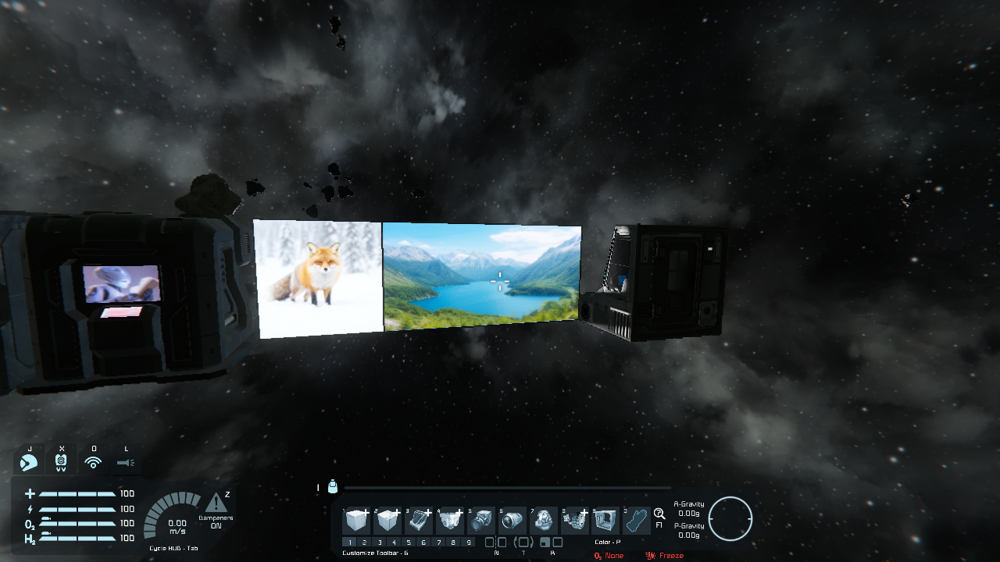
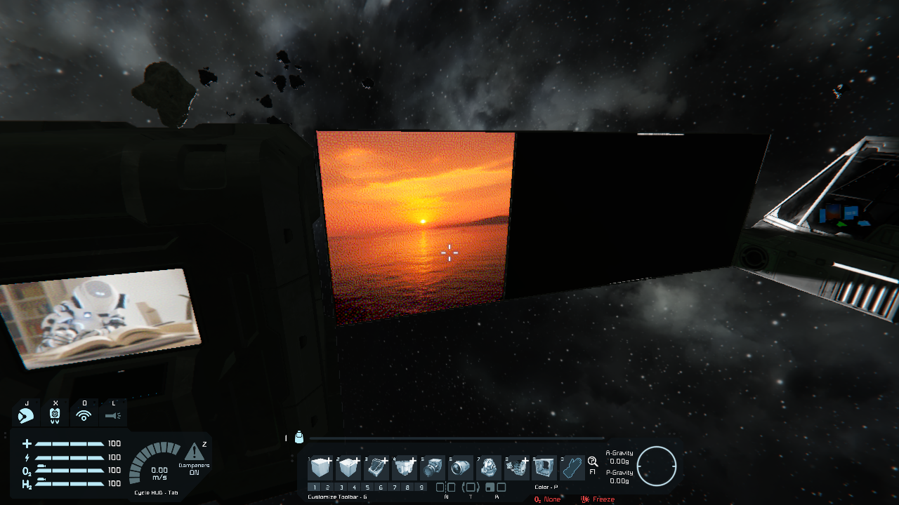

# LCD Image Generation

Space Engineers 1 plugins that turn a prompt into an image on an LCD. Write `/ig <prompt>` on a
screen, or look at it and send it in chat, for example `/ig a red fox in the snow`. The
[MOSS-Image-SFT](https://huggingface.co/OpenMOSS-Team/MOSS-Image-SFT) model generates the
picture in the background, and the screen shows it as color-character art at the highest
resolution it can hold.

- **Server plugin** (Magnetar): generates on a dedicated server.
- **Client plugin** (Pulsar): generates where the local game is the server, offline and when
  hosting a friends game. Players who join need no plugin, they get the images through the
  game's normal LCD sync.
- **Image server**: the model runs in an `sd-server` of
  [stable-diffusion.cpp](https://github.com/leejet/stable-diffusion.cpp) on any host with a
  16 GB GPU. The plugins call its HTTP API at `ImageServerUrl` in `LcdImageGen.cfg`, for
  example `http://192.168.1.20:1234`, so the game and the model can be on different machines. An image takes about 8 s on a Radeon AI PRO R9700.

## Writing a prompt

| Where | How | When |
|---|---|---|
| On the screen | `/ig <prompt>` as the screen's text | Any screen, also from scripts |
| Chat | `/ig <prompt>`, `/ig #<screen> <prompt>` | Looking at a screen within 10 m |
| Chat | `!ig ...`, the same | Only if `/ig` is taken by another client plugin or mod |

Both chat prefixes do the same thing. `#<screen>` picks a screen of a block with several, such
as a cockpit, counted from 0; without it the first screen is used.

The chat command aimed at an LCD:

## Documentation

- [Usage](Docs/usage.md): prompts on screens and in chat, `/ig` or `!ig`, Custom Data history
- [Running the image model](Docs/image-server.md): host, build, weights, command line, systemd
- [Configuration](Docs/configuration.md): `LcdImageGen.cfg` options
- [How it works](Docs/how-it-works.md): hooks, threading, image conversion, screen resolution
- [Build and test](Docs/development.md): building, unit tests and the game test rig
